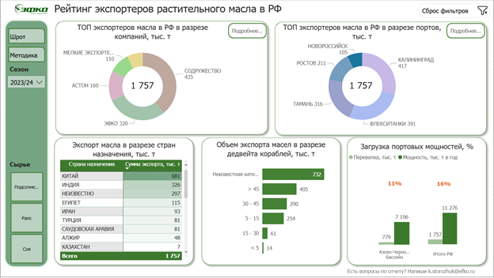
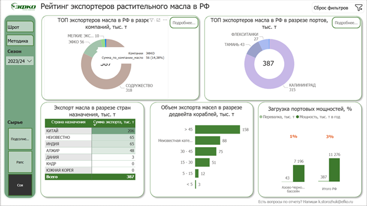

# Экспорт масел и шротов: компании, порты и направления

**Power BI-кейс: TOP 5, детализация отгрузок и портовые мощности**

Отчёт организует анализ экспорта масел и шротов по компаниям, портам, странам и времени. Обзорные страницы дополняются детализацией отгрузок, ранжированием и текстовыми подсказками об участниках вне TOP 5.

Power BI · Power Query M · DAX · Excel · моделирование данных

## Как выглядит отчёт

### Обзор экспорта растительного масла



**Состояние:** Страница масла; сезон 2023/24; отдельная культура не выделена.

На одном экране представлены структуры экспорта по компаниям и портам, страны назначения, группы дедвейта и отображаемое отношение отгрузок к портовым мощностям. Слева расположены фильтры и навигация.

### Соевое масло: фильтр и подсказка на диаграмме



**Состояние:** Страница масла; сезон 2023/24; культура «Соя»; открыта подсказка у сектора кольцевой диаграммы.

Кадр показывает применение фильтра сырья и чтение точного значения через tooltip. Рядом остаются распределение по портам, направления поставок, дедвейт и мощности для текущего среза.

[Все состояния в галерее: 4](docs/GALLERY.md) · [Интерфейс и навигация](docs/REPORT_GUIDE.md) · [Модель данных](docs/ARCHITECTURE.md).

## Задача

- Подготовить два согласованных потока экспортного мониторинга и общие справочники.
- Показать лидеров экспорта, географию отгрузок и распределение по портам и бассейнам.
- Сопоставить объёмы отгрузок с портовыми мощностями и дать переход к деталям выбранного среза.

## Выполненная работа

- Power Query M для разделения масла/шрота, выбора полей, нормализации названий и типов, замен по справочнику и группировки дедвейта.
- Модель двух фактов, мощностей и общих измерений дат, грузов, экспортёров и портов.
- DAX для ранжирования, остатка вне TOP 5, CONCATENATEX-подсказок и соотношения объёмов с мощностями.
- Отдельные страницы обзора и детализации масла/шрота, фильтры, навигация и bookmarks.

## Результат

Подготовлен многостраничный отчёт по экспортному мониторингу с обзором и детализацией. Устройство раскрыто через модель, формулы, конфигурацию PBIX и настоящие экраны страниц масла/шрота с примерами фильтрации и tooltip. Измеренный эффект на бизнес-решения в материалах не зафиксирован.

## Что демонстрирует кейс

BI-аналитик и аналитик данных: нормализация справочников, DAX-ранжирование, текстовые меры, исследование логистических данных.

Модель содержит 10 бизнес-таблиц, 10 связей и 27 явных DAX-мер. M-запросы в комплекте: подготовительный слой - 5, модель Power BI - 8.

## Технический разбор

- [Полная галерея экранов и состояний фильтров](docs/GALLERY.md).
- [Модель, зерно, связи и trade-offs](docs/ARCHITECTURE.md).
- [Power Query: обработка исходных форм и подготовка модели](docs/DATA_PREPARATION.md).
- [DAX: меры, вычисляемые таблицы и столбцы](docs/METRICS.md).
- [Интерфейс и сценарии использования](docs/REPORT_GUIDE.md).
- [Проверки расчётов и ограничения](docs/VALIDATION.md).
- [Как читать и восстановить проект](docs/REPRODUCING.md).
- [Дополнительные схемы компоновки страниц](docs/LAYOUTS.md).

## Состав repository

```text
assets/screenshots/      настоящие экраны отчёта и индекс изображений
assets/                  дополнительные схемы модели и страниц
docs/                    архитектура, ETL, метрики, интерфейс и проверки
src/power-query/source/  запросы подготовительных Excel-книг
src/power-query/model/   запросы семантической модели Power BI
src/power-query/parameters/  параметры путей
src/dax/                 меры, вычисляемые таблицы и столбцы
src/relationships.csv    ключи и направления фильтрации
```

Repository показывает выполненный отчёт на настоящих снимках, его архитектуру и код. Исходные таблицы данных и PBIX не включены, поэтому автономный Refresh после клонирования не заявлен. M/DAX при подготовке не исполнялись; правила проверок перечислены отдельно. [Состав и права](RIGHTS.md).
