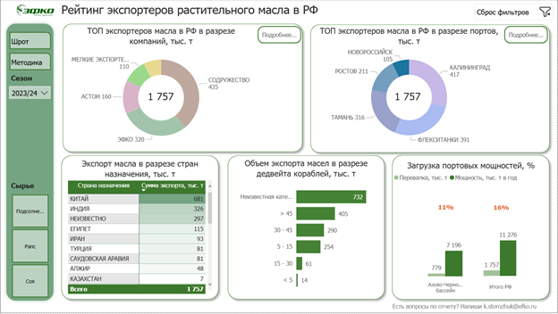
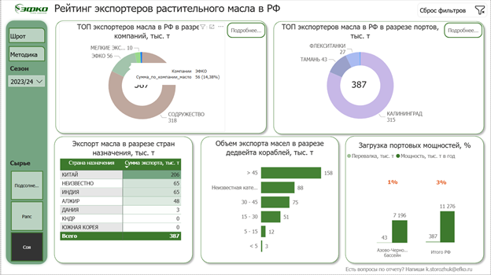
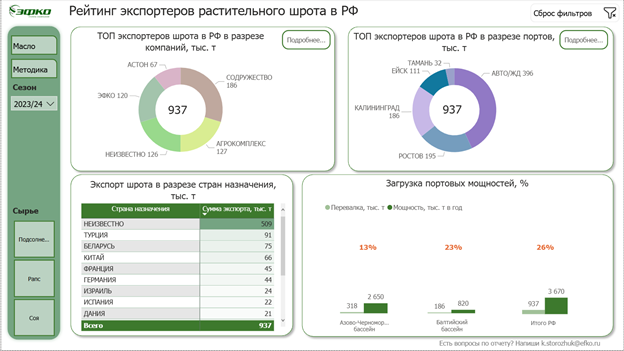
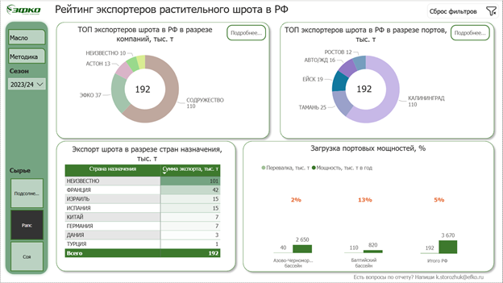

# Отчёт в работе: экраны и аналитические состояния

Настоящие снимки выполненного Power BI-отчёта. PNG перенесены без изменения пикселей; это сохранённые состояния, не реконструкция интерфейса и не текущая сводка рынка. Подписи описывают видимые выборы на экранах, а не только названия исходных файлов. Клики и Refresh при подготовке галереи не запускались.

## 1. Обзор экспорта растительного масла

**Состояние:** Страница масла; сезон 2023/24; отдельная культура не выделена.

На одном экране представлены структуры экспорта по компаниям и портам, страны назначения, группы дедвейта и отображаемое отношение отгрузок к портовым мощностям. Слева расположены фильтры и навигация.

## 2. Соевое масло: фильтр и подсказка на диаграмме

**Состояние:** Страница масла; сезон 2023/24; культура «Соя»; открыта подсказка у сектора кольцевой диаграммы.

Кадр показывает применение фильтра сырья и чтение точного значения через tooltip. Рядом остаются распределение по портам, направления поставок, дедвейт и мощности для текущего среза.

## 3. Обзор экспорта шротов

**Состояние:** Страница шрота; сезон 2023/24; отдельная культура не выделена.

Вторая тематическая страница сохраняет знакомую логику навигации и показывает состав экспортёров, порты, страны назначения и показатели портовых мощностей для шрота.

## 4. Соевый шрот: изменение аналитического среза

**Состояние:** Страница шрота; сезон 2023/24; культура «Соя».

После выбора культуры видны другой состав компаний и портов, направления поставок и показатели текущего среза. Правила сопоставления объёмов с годовой мощностью рассматриваются в описании расчётов.

[Обзор проекта](../README.md) · [Интерфейс и навигация](REPORT_GUIDE.md) · [Модель](ARCHITECTURE.md) · [Проверки расчётов](VALIDATION.md).
